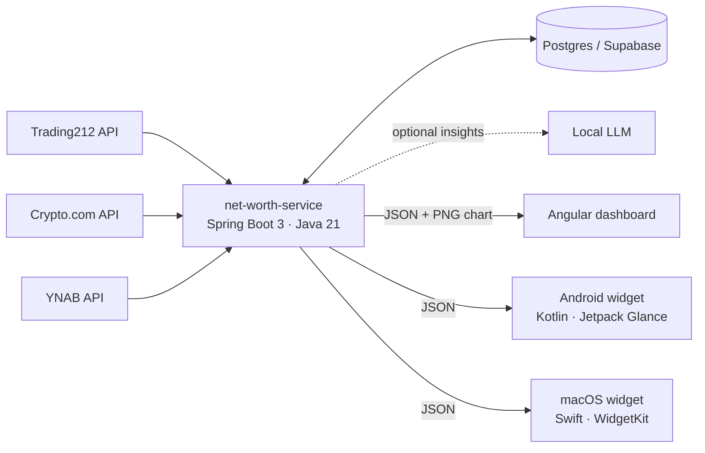

# Net Worth Dashboard

A personal net-worth tracker I built and run for myself. A Spring Boot service snapshots my brokerage and crypto balances once a day, stores the history in Postgres, and serves it to three clients: an Angular dashboard, an Android home-screen widget and a macOS widget.

Neither Trading212 nor Crypto.com offers a "portfolio value over time" API; both only return the live balance. This service builds the history itself, one data point per day.

> This is a public showcase copy of a private repository. Personal data and deployment secrets are not included.



## What's in here

| Folder | What it is |
|---|---|
| [`net-worth-service`](net-worth-service) | Spring Boot 3.3 / Java 21 API. Scheduled daily snapshots, Spring Data JPA on Postgres, JFreeChart PNG charts, compound-interest projections, optional spend commentary from a local OpenAI-compatible LLM. Multi-stage Dockerfile. |
| [`net-worth-frontend`](net-worth-frontend) | Angular dashboard with an access-key gate, dark mode and the history chart. Deployed as a static site. |
| [`net-worth-android`](net-worth-android) | Kotlin + Jetpack Glance widget. Reads from a local cache, refreshes hourly with WorkManager and works offline. |
| [`net-worth-macos`](net-worth-macos) | SwiftUI + WidgetKit widget in four sizes, with its core logic in a separate Swift package so it can be unit-tested without Xcode. |
| [`docs/superpowers`](docs/superpowers) | The design specs and implementation plans each feature was built from. |

## Engineering notes

- **One API, three clients.** The service owns all the logic (history, projections, goal progress). The clients are thin and render what it returns.
- **Secure by default for a public endpoint.** Every `/api/**` call needs a shared secret in the `X-Api-Key` header, CORS is restricted to the configured frontend origin, and the credential-bearing source integrations are each optional.
- **Deployment.** The backend ships as a Docker image to a VPS behind Traefik, with Supabase Postgres as the database. The frontend is a static site.
- **Tested where it matters.** The macOS core package and the Android logic have unit-test suites that run without a device or an Xcode project.

## Run the backend locally

Requires Docker; the Compose file brings its own Postgres.

```bash
cd net-worth-service
docker compose up --build
```

Configuration is by environment variable. See [`net-worth-service/README.md`](net-worth-service/README.md) for the full list and the API reference.

## Stack

Java 21 · Spring Boot 3.3 · Spring Data JPA · Postgres · Docker · Angular · TypeScript · Kotlin · Jetpack Glance · Swift · WidgetKit · GitHub Actions
